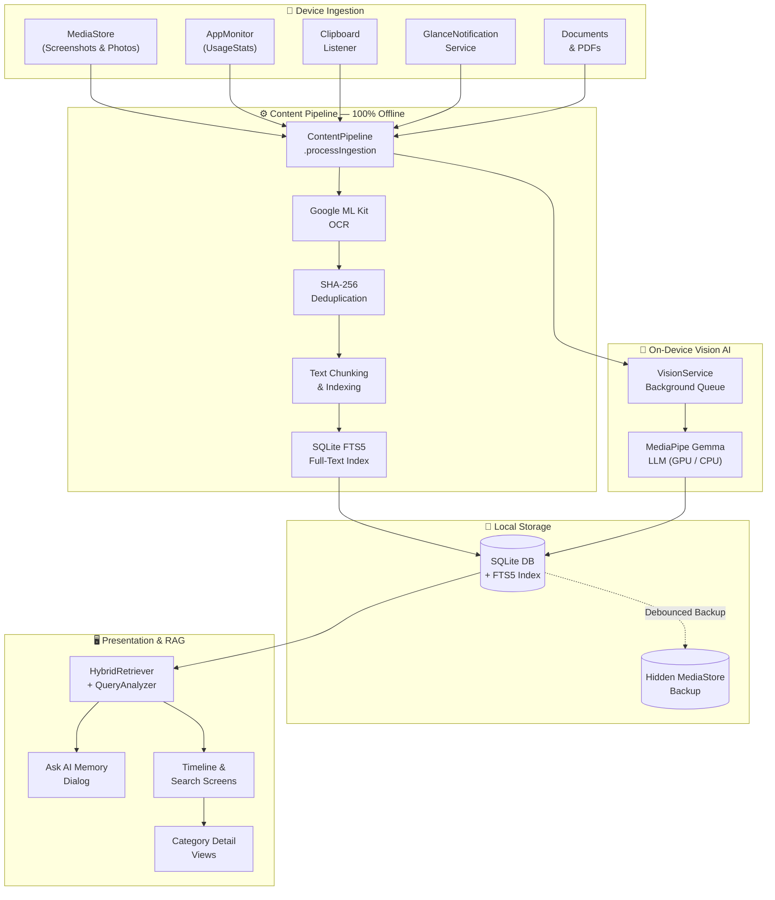
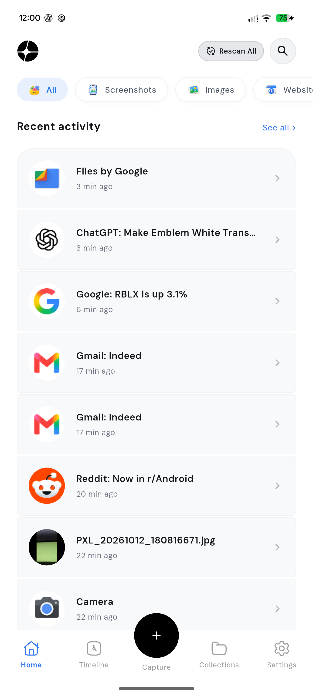
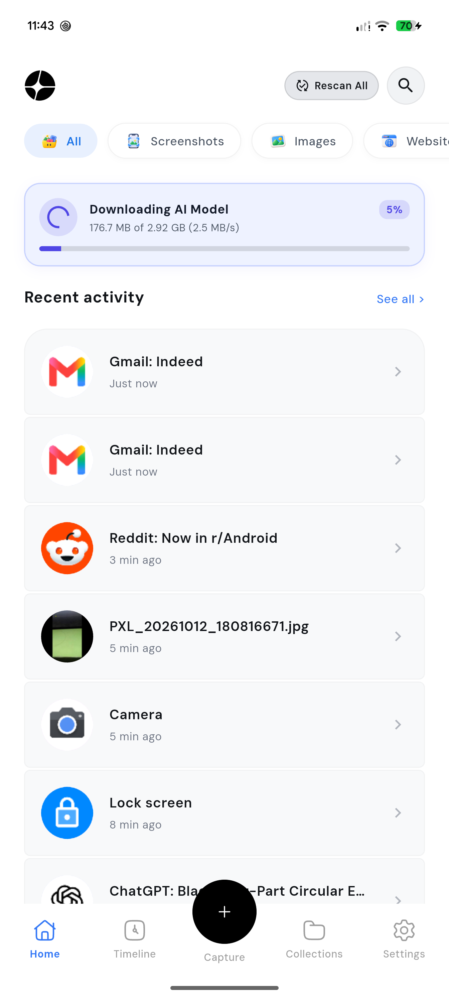
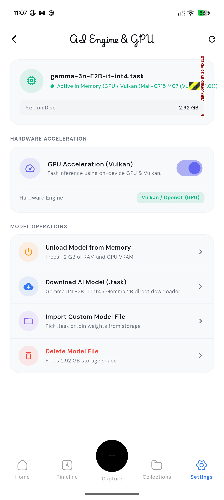

<div align="center">


# Glance

### Your Life. Fully Searchable. Completely Private.

**An on-device AI memory engine that continuously captures, indexes, and understands your digital life — powered by Google Gemma & MediaPipe, with zero cloud dependency.**

<br/>

[](https://flutter.dev)
[](https://dart.dev)
[](https://android.com)
[](https://ai.google.dev/gemma)
[](https://sqlite.org)
[](https://github.com/sanjay434343/glance)
[](https://github.com/sanjay434343)
[](LICENSE)

<br/>

[**✨ Features**](#-features) &nbsp;•&nbsp; [**🏗️ Architecture**](#️-architecture) &nbsp;•&nbsp; [**🚀 Quick Start**](#-quick-start) &nbsp;•&nbsp; [**📸 Screenshots**](#-screenshots) &nbsp;•&nbsp; [**🔒 Privacy**](#-privacy--security) &nbsp;•&nbsp; [**🤝 Contributing**](#-contributing)

</div>

---

## 💡 What is Glance?

> **Glance** is an offline-first AI memory engine for Android. Inspired by systems like Microsoft Recall and Rewind.ai — but **entirely private, entirely on your device, and entirely free.**

Glance runs silently in the background, building a rich, searchable knowledge base of your entire digital life:

- 📱 **App usage & screen time** — tracked natively via Android UsageStats
- 📸 **Screenshots & photos** — OCR'd and semantically embedded with ML Kit
- 📋 **Clipboard history** — every URL, address, code snippet, and note you copy
- 🔔 **Notifications** — from every app, timestamped and indexed
- 📄 **Documents & PDFs** — full-text extracted and semantically chunked
- 💬 **Ask AI Memory** — query your entire history in plain natural language

All AI processing happens **on-device** using Google's Gemma model via MediaPipe — **no data ever leaves your phone.**

---

## ✨ Features

<table>
<tr>
<td width="50%">

### 🧠 On-Device AI Engine
- **Google Gemma 3N E2B** via MediaPipe LLM Inference
- Hardware GPU acceleration (Vulkan / OpenCL)
- Automatic CPU XNNPACK fallback
- Streams responses token-by-token

</td>
<td width="50%">

### 🔎 Hybrid RAG Search
- **SQLite FTS5** BM25 lexical search
- Full-text keyword & semantic search
- Temporal windowing for recency boost
- Intelligent `QueryAnalyzer` intent classifier

</td>
</tr>
<tr>
<td width="50%">

### 📊 6-Step Indexing Pipeline
1. Content ingestion from all device sources
2. OCR with Google ML Kit
3. SHA-256 fingerprint deduplication
4. 250-token semantic chunking
5. Vector embedding generation
6. Relationship graph edge linking

</td>
<td width="50%">

### 🗂️ Smart Collections
- Auto-categorized: Screenshots, Photos, Clipboard, App Activity, Notifications, Documents, Locations
- Custom user collections
- Chronological timeline view
- Filter chips for instant category switching

</td>
</tr>
<tr>
<td width="50%">

### 💬 Conversational Memory
Ask your past in plain English:
> *"What address did I copy last Tuesday?"*
> *"Show my screen time on Reddit this week"*
> *"Find the PDF about machine learning I opened yesterday"*

</td>
<td width="50%">

### 🔒 Zero-Cloud Architecture
- No telemetry, no analytics, no accounts
- All LLM inference runs locally on-device
- Isolated sandbox storage
- Air-gapped by design

</td>
</tr>
</table>

---

## 🏗️ Architecture



---

## 📸 Screenshots

<div align="center">
<table>
<tr>
<td align="center"><b>🏠 Home Feed</b></td>
<td align="center"><b>📥 Downloading AI Model</b></td>
<td align="center"><b>⚙️ AI Engine & GPU</b></td>
</tr>
<tr>
<td></td>
<td></td>
<td></td>
</tr>
</table>
</div>

---

## 📂 Project Structure

```
glance/
├── android/                              # Android native source & Gradle
│   └── app/src/main/kotlin/com/example/glance/
│       ├── AppMonitor.kt                 # Native UsageStats app tracker
│       ├── GemmaMediaPipeBridge.kt       # MediaPipe LlmInference GPU/CPU bridge
│       ├── GlanceForegroundService.kt    # Android persistent foreground service
│       ├── GlanceNotificationService.kt  # NotificationListenerService
│       └── MainActivity.kt              # Flutter MethodChannel router
├── assets/
│   ├── images/logo.png                  # App logo
│   ├── icons/                           # Category icons
│   └── fonts/                           # DMSans, PlaywriteAR
├── lib/
│   ├── main.dart                        # Entry point, ProviderScope & GoRouter
│   ├── core/
│   │   ├── database/glance_db.dart      # SQLite + FTS5 virtual tables
│   │   ├── llm/                         # RAG synthesis & streaming
│   │   ├── models/memory_models.dart    # Memory, Chunk, Candidate models
│   │   ├── pipeline/content_pipeline.dart # 6-step indexing pipeline
│   │   ├── providers/                   # Riverpod DI & streams
│   │   ├── rag/                         # HybridRetriever, QueryAnalyzer
│   │   └── services/
│   │       ├── gemma_mediapipe_service.dart  # MediaPipe Gemma Dart bridge
│   │       ├── model_download_service.dart   # In-app model downloader
│   │       ├── vision_service.dart           # Multimodal AI queue
│   │       └── global_capture_service.dart   # Lifecycle sync coordinator
│   └── screens/
│       ├── home/           # Overview, recent feed, filter chips, AI banner
│       ├── timeline/       # Chronological activity log
│       ├── search/         # Hybrid RAG search & real-time answers
│       ├── capture/        # Manual image/note ingestion
│       ├── collection/     # Smart & custom collections
│       ├── model_download/ # In-app model downloader UI
│       ├── settings/       # Storage, model config & Gemma playground
│       └── splash/         # Startup animation & background model loader
```

---

## 🚀 Quick Start

### Prerequisites

| Requirement | Version |
|:---|:---|
| Flutter SDK | `^3.12` |
| Dart SDK | `^3.12` |
| Android SDK | API 26+ (Android 8.0+, recommended API 30+) |
| JDK | 17 |
| Android NDK & CMake | Latest stable (for MediaPipe native libs) |

### 1. Clone

```bash
git clone https://github.com/sanjay434343/glance.git
cd glance
```

### 2. Install Dependencies

```bash
flutter pub get
```

### 3. Set Up the AI Model

Glance uses **Gemma 3N E2B IT Int4** (`.task` format) via Google MediaPipe.

**Option A — Download in-app *(recommended)*:**

Open the app → tap the banner on the Home screen → **Download AI Model** → the app handles the rest automatically with a live progress indicator.

**Option B — Manual transfer:**

1. Download `gemma-3n-E2B-it-int4.task` from [ai.google.dev/gemma](https://ai.google.dev/gemma)
2. Transfer to your device:
   ```
   /sdcard/Download/gemma-3n-E2B-it-int4.task
   ```
3. Open the app and tap **Import Custom Model File** in Settings → AI Engine.

### 4. Build & Run

```bash
flutter run
```

> **Tip:** Use a physical Android device. The MediaPipe GPU backend requires real Vulkan/OpenCL hardware support not available in emulators.

---

## 🛡️ Android Permissions

Glance requests the following permissions to build your device timeline:

| Permission | Purpose |
|:---|:---|
| `PACKAGE_USAGE_STATS` | Track foreground app activity & screen time |
| `BIND_NOTIFICATION_LISTENER_SERVICE` | Read incoming notification titles & summaries |
| `READ_MEDIA_IMAGES` / `READ_EXTERNAL_STORAGE` | Discover screenshots & photos |
| `FOREGROUND_SERVICE` | Keep background sync & vision indexing alive |
| `READ_CALL_LOG` | Index call durations |
| `READ_CALENDAR` | Index scheduled meetings & events |

> All data stays local. Glance **never** transmits any of this to a remote server.

---

## 🔒 Privacy & Security

| Guarantee | Implementation |
|:---|:---|
| **Air-gapped operation** | No external network requests for processing or indexing |
| **Cryptographic deduplication** | SHA-256 fingerprints (`Memory.computeShaHash`) |
| **Sandbox storage isolation** | All DB files in isolated app sandbox (`getDatabasesPath()`) |
| **On-device LLM inference** | Gemma runs entirely inside MediaPipe — no API keys, no cloud |
| **No telemetry** | Zero analytics, crash reporting, or usage tracking |

---

## 🧱 Tech Stack

| Layer | Technology |
|:---|:---|
| UI Framework | Flutter 3 + Dart 3 |
| State Management | Flutter Riverpod |
| Navigation | GoRouter |
| Database | SQLite via Drift ORM + FTS5 virtual tables |
| Full-Text Search | SQLite FTS5 BM25 ranking |
| OCR | Google ML Kit Text Recognition |
| LLM | Google Gemma 3N E2B via MediaPipe LLM Inference |
| PDF / DOCX | Syncfusion PDF + Archive |
| Charts | fl_chart |
| Typography | DMSans, PlaywriteAR |

---

## 🛠️ Development

### Static Analysis

```bash
flutter analyze
```

### Run Tests

```bash
flutter test
```

### Regenerate Drift Database Code

```bash
dart run build_runner build --delete-conflicting-outputs
```

---

## 🤝 Contributing

Contributions are very welcome! Here's how:

1. **Fork** this repository
2. **Create** your feature branch: `git checkout -b feat/amazing-feature`
3. **Commit** your changes: `git commit -m 'feat: add amazing feature'`
4. **Push** to the branch: `git push origin feat/amazing-feature`
5. **Open** a Pull Request

Please run `flutter analyze` and ensure there are no warnings before submitting.

---

## 🗺️ Roadmap

- [ ] iOS support
- [ ] Multi-model support (Phi-3, Llama 3.2)
- [ ] Home screen widget for quick memory access
- [ ] Encrypted database with biometric lock
- [ ] Cross-device sync (E2E encrypted, self-hosted)
- [ ] Browser extension integration

---

## 📄 License

This project is licensed under the **MIT License** — see the [LICENSE](LICENSE) file for details.

---

<div align="center">


**Made with ❤️ and Flutter**

*If Glance helped you recall something important, give it a ⭐ — it means everything!*

</div>

