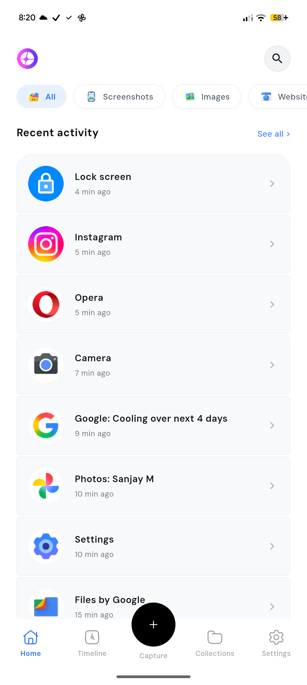
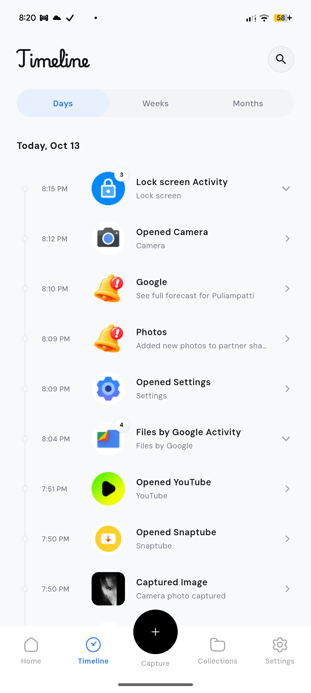
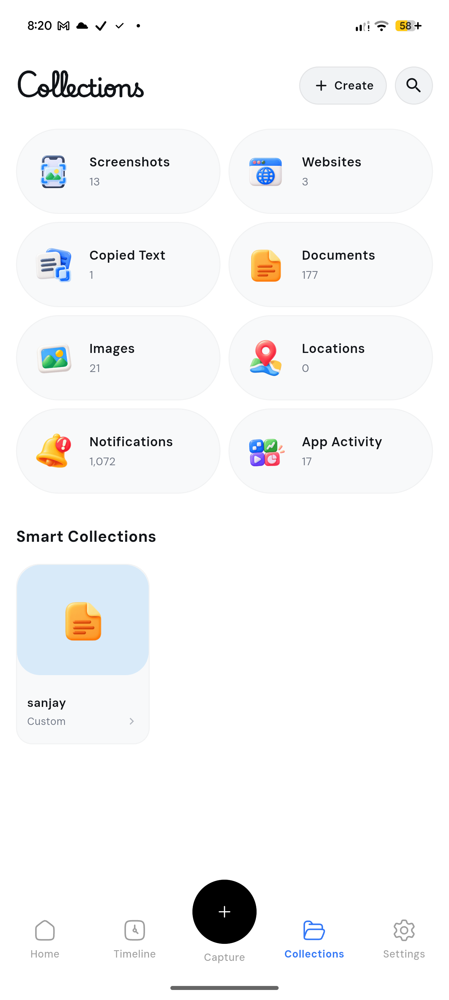
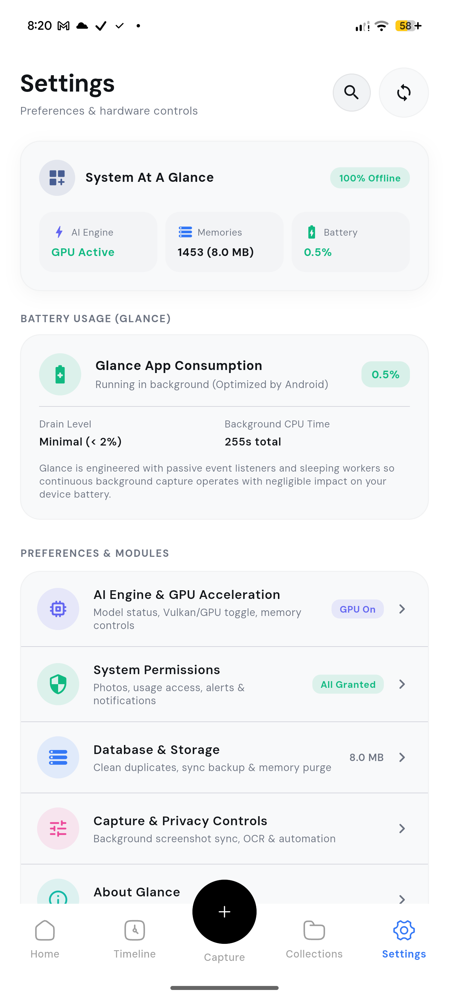
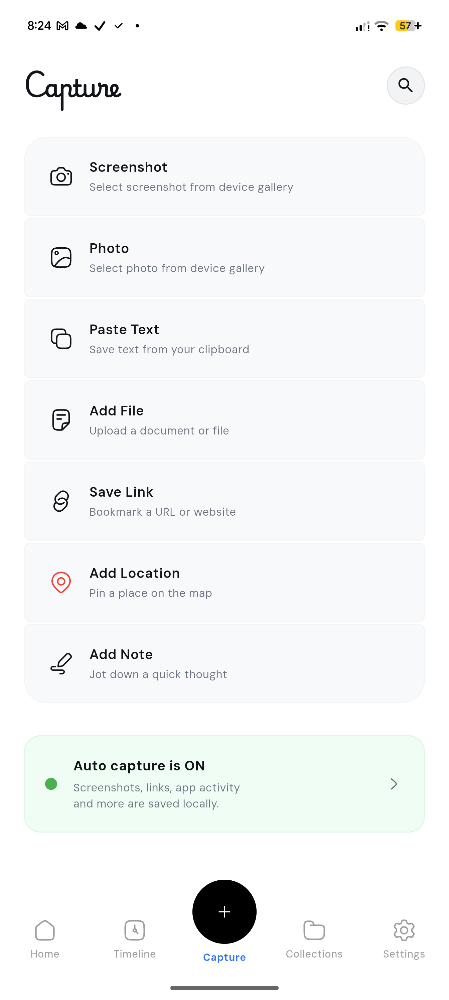
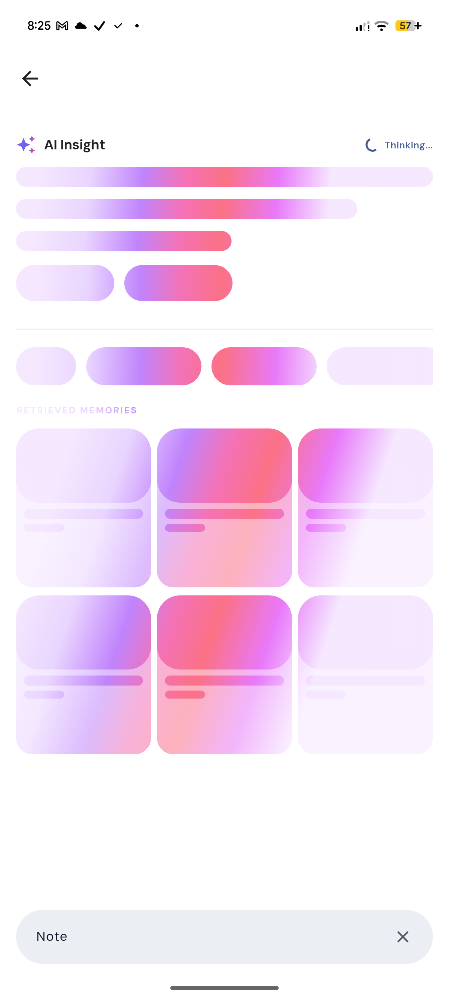
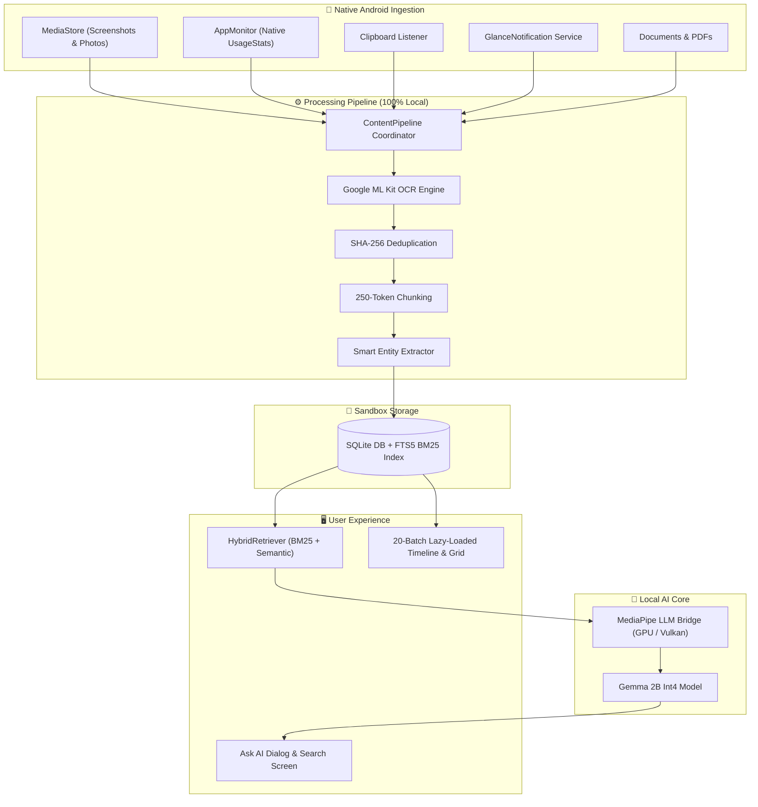

<div align="center">


# Glance

### Your Life. Fully Searchable. Completely Private.

**An open-source on-device AI memory engine for Android that continuously captures, indexes, and understands your digital life — powered by Google Gemma 2B & MediaPipe, with zero cloud dependency.**

<br/>

[](https://github.com/sanjay434343/Glance/releases)
[](https://github.com/sanjay434343/Glance/stargazers)
[](https://flutter.dev)
[](https://android.com)
[](https://ai.google.dev/gemma)
[](https://github.com/sanjay434343/Glance)
[](LICENSE)

<br/>

### 📲 [Download Latest APK (v1.0.0)](https://github.com/sanjay434343/Glance/releases/latest)

[-3478F6?style=for-the-badge&logo=android&logoColor=white)](https://github.com/sanjay434343/Glance/releases/latest)
[-6B7280?style=for-the-badge&logo=android&logoColor=white)](https://github.com/sanjay434343/Glance/releases/latest)
[-6B7280?style=for-the-badge&logo=android&logoColor=white)](https://github.com/sanjay434343/Glance/releases/latest)

<br/>

[**⚡ The 10-Second Pitch**](#-why-glance) &nbsp;•&nbsp; [**📸 Screenshots**](#-screenshots) &nbsp;•&nbsp; [**✨ Features**](#-features) &nbsp;•&nbsp; [**🏗️ Architecture**](#️-architecture) &nbsp;•&nbsp; [**🚀 Quick Start**](#-quick-start) &nbsp;•&nbsp; [**🔒 Privacy**](#-privacy--security)

</div>

---

## ⚡ Why Glance? (The 10-Second Pitch)

Ever remember reading a crucial note, seeing an address in a screenshot, or copying a verification code yesterday — only to spend 15 minutes fruitlessly searching through 10 different apps?

**Glance solves this silently in the background.** It creates a local, chronological memory graph of your digital life. Ask it anything in natural language, and your local AI finds it in milliseconds.

### 🥊 How Glance Compares

| Feature | 🛡️ **Glance** | 🪟 Microsoft Recall | ☁️ Cloud AI / Rewind |
| :--- | :---: | :---: | :---: |
| **Privacy & Telemetry** | **100% On-Device, Zero Tracking** | Questionable / Windows Cloud Sync | Cloud Server Uploads |
| **Local AI Engine** | **Google Gemma 2B (MediaPipe)** | Proprietary NPU Copilot | Remote Cloud APIs |
| **Offline Operation** | **100% Fully Offline** | Hybrid Cloud | Requires Active Internet |
| **Source Code** | **Open Source (MIT)** | Closed Source | Proprietary |
| **Performance** | **20-Item Batch Lazy Loading (60 FPS)** | Heavy Resource Spikes | Battery & Data Heavy |
| **Platform** | **Android 8.0+** | Windows 11 Copilot+ PCs only | macOS / iOS |

---

## 📸 Screenshots

<div align="center">
<table>
<tr>
<td align="center"><b>🏠 Home</b></td>
<td align="center"><b>⏱️ Timeline</b></td>
<td align="center"><b>🗂️ Collection</b></td>
</tr>
<tr>
<td></td>
<td></td>
<td></td>
</tr>
<tr>
<td align="center"><b>⚙️ Settings</b></td>
<td align="center"><b>➕ Capture</b></td>
<td align="center"><b>🔍 Search & AI Model</b></td>
</tr>
<tr>
<td></td>
<td></td>
<td></td>
</tr>
</table>
</div>

---

## ✨ Features

<table>
<tr>
<td width="50%">

### 🧠 On-Device Gemma 2B Intelligence
- **Google Gemma 3N E2B Int4** powered by MediaPipe
- Native GPU hardware acceleration (Vulkan / OpenCL)
- Automatic CPU XNNPACK fallback
- Token-by-token streaming inference with **0 cloud dependency**

</td>
<td width="50%">

### 🔎 Hybrid RAG Retrieval Engine
- **SQLite FTS5** lexical indexing with BM25 ranking
- Vector & semantic search combined
- Recency decay & temporal windowing
- Intent classification with smart query expansion

</td>
</tr>
<tr>
<td width="50%">

### ⚡ 20-Item Batch Lazy Loading
- Rock-solid 60 FPS scrolling even with thousands of memories
- Paginated in 20-item lazy-loaded batches
- Guarded isolate extraction prevents memory spikes
- Capped OCR & document analysis prevents ANR lockups

</td>
<td width="50%">

### 📱 360° Device Data Capture
- **App Usage & Screen Time** via Android `UsageStats`
- **Screenshots & Photos** with Google ML Kit OCR
- **Clipboard History** with entity parsing (OTPs, URLs, emails)
- **Notifications & Calls** captured and indexed locally

</td>
</tr>
<tr>
<td width="50%">

### 🗂️ Smart & Custom Collections
- Auto-organized categories: Screenshots, Photos, Clipboard, Documents, App Usage, Notifications
- Custom user-defined tags and folders
- Chronological timeline views (Days / Weeks / Months)

</td>
<td width="50%">

### 🔒 Air-Gapped by Design
- No accounts, no subscriptions, no tracking
- Cryptographic SHA-256 fingerprint deduplication
- All SQLite databases isolated in Android app sandbox
- Does not contain a single analytics SDK

</td>
</tr>
</table>

---

## 🏗️ Architecture



---

## 🚀 Quick Start

### 1. Download Prebuilt APK (Easiest)
Download the `.apk` directly from [GitHub Releases](https://github.com/sanjay434343/Glance/releases/latest):
- **`app-arm64-v8a-release.apk`**: Most modern Android smartphones (recommended).
- **`app-armeabi-v7a-release.apk`**: Older 32-bit Android phones.
- **`app-x86_64-release.apk`**: Emulators and ChromeOS devices.

### 2. Build From Source

#### Prerequisites:
- **Flutter SDK**: `^3.12`
- **Dart SDK**: `^3.12`
- **Android SDK**: API 26+ (Android 8.0+, recommended API 30+)
- **JDK**: 17

```bash
# 1. Clone the repository
git clone https://github.com/sanjay434343/Glance.git
cd Glance

# 2. Install Flutter packages
flutter pub get

# 3. Build optimized release APKs
flutter build apk --split-per-abi

# 4. Or run directly on your connected device
flutter run --release
```

---

## 🔒 Privacy & Permissions

Glance requests the following permissions purely to index your local activity. **No data ever leaves your device:**

| Permission | Purpose |
| :--- | :--- |
| `PACKAGE_USAGE_STATS` | Measure active app foreground duration and screen time |
| `BIND_NOTIFICATION_LISTENER_SERVICE` | Privately index notification text and message titles |
| `READ_MEDIA_IMAGES` / `READ_EXTERNAL_STORAGE` | Discover local screenshots, images, and documents |
| `FOREGROUND_SERVICE` | Keep background OCR and memory indexing responsive |

---

## 🗺️ Roadmap

- [x] On-device Gemma 2B via MediaPipe GPU inference
- [x] SQLite FTS5 BM25 Hybrid RAG
- [x] 20-item batch lazy loading & lag-free document extraction
- [x] App usage, notification, and screenshot ingestion
- [ ] Biometric lock & encrypted database option
- [ ] Support for lightweight Llama 3.2 / Qwen 2.5 models
- [ ] F-Droid & IzzyOnDroid release packages
- [ ] Export memory graph as Markdown / JSON

---

## 🤝 Contributing

Contributions make open-source amazing!
1. **Fork** the repo
2. **Create** your feature branch: `git checkout -b feat/amazing-feature`
3. **Commit** your changes: `git commit -m 'feat: Add amazing feature'`
4. **Push** to the branch: `git push origin feat/amazing-feature`
5. **Open a Pull Request**

---

## 📄 License

Distributed under the **MIT License**. See [LICENSE](LICENSE) for more information.

---

<div align="center">


### **Built with ❤️ using Flutter & Google Gemma**

**If you love privacy and on-device AI, please give Glance a ⭐ — it helps the project grow!**

</div>
